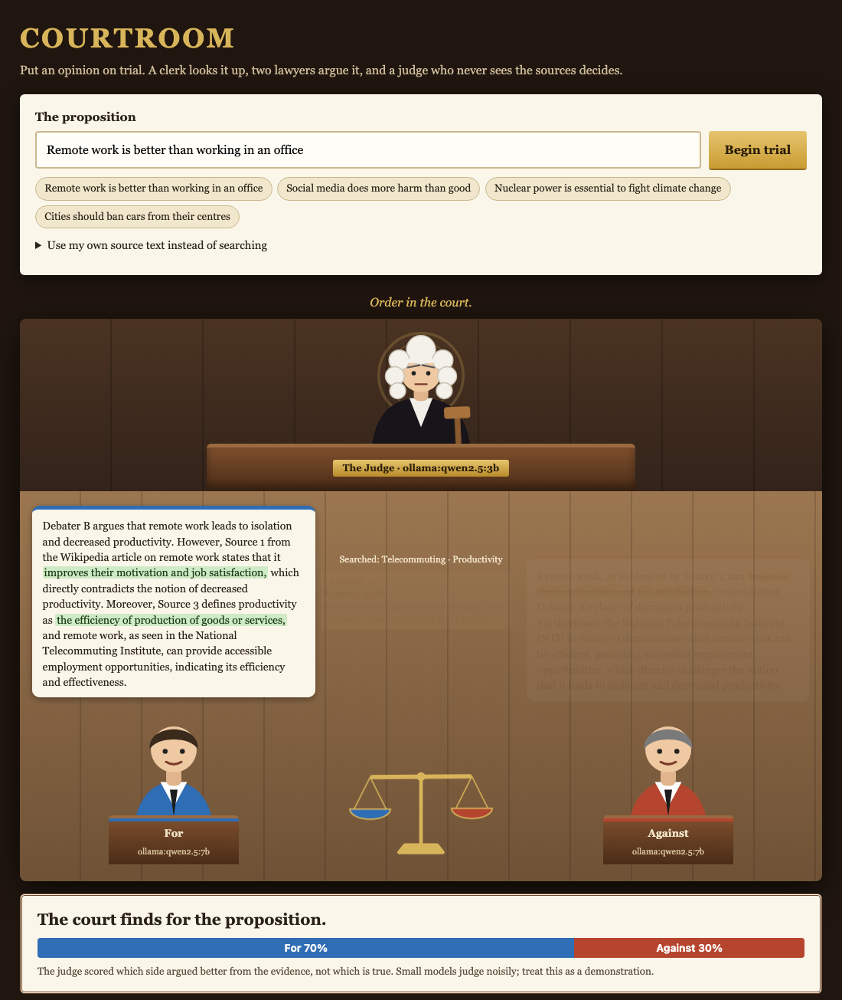
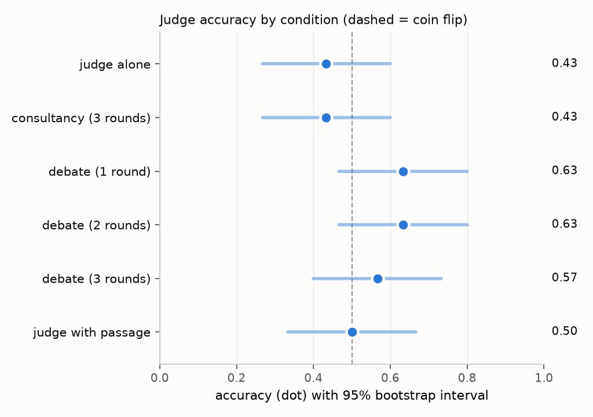
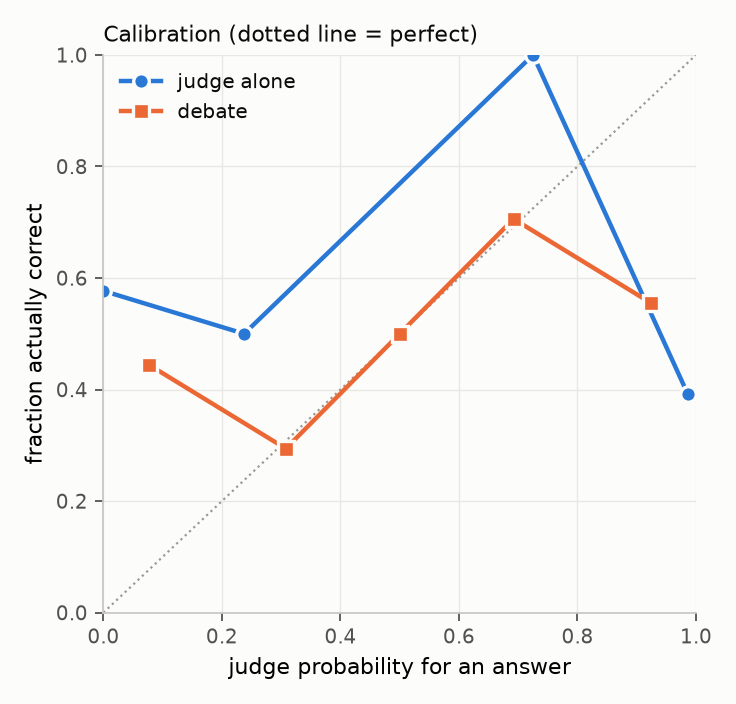

# Courtroom

Put an opinion on trial. A clerk looks it up on Wikipedia, two language models argue opposite sides, and a weaker judge who never sees the sources decides who made the better case.



## Overview

I built this to try out an idea from the paper "Debating with More Persuasive LLMs Leads to More Truthful Answers" (Khan et al., 2024): if a judge can't check the facts itself, can watching two stronger models argue help it get to the right answer? The paper's setup is a judge that can't see the source text, debaters that can, and a check on every quote.

There are two halves. The first is the demo above, which turns that setup into a small web app you can type a topic into. The second is a research pipeline that measures whether debate actually helps, on QuALITY, a set of long stories with multiple-choice questions.

Everything runs for free on local models through Ollama. I wrote the Anthropic API path too, with a hard spend cap, but I have not run it on the real API, only against a fake client in the tests.

## An example

The screenshot is a real run. I typed "Remote work is better than working in an office" and this happened:

1. The clerk picked a few Wikipedia article titles, fetched them, and put them on the evidence table as exhibits.
2. Debater A argued for the proposition and Debater B against it, two rounds each, quoting from the exhibits.
3. Code checked every quote against the exhibit text. Green quotes were found, red struck-through ones were not.
4. The judge saw only the transcript and scored how strong each case was. The scales tipped 70/30 for the proposition.

The judge is scoring who argued better from the evidence, not who is right. Small models do this noisily, so treat a verdict as a demonstration.

## Repository structure

```text
├── assets/                  # screenshot and charts used in this README
├── courtroom/
│   ├── app.py               # FastAPI demo, streams a trial over server-sent events
│   ├── search.py            # the clerk: picks titles, fetches Wikipedia extracts
│   ├── debate.py            # debaters, judge, quote checking, prompt building
│   ├── llm.py               # one call() for every model: cache, retries, spend cap
│   ├── data.py              # downloads QuALITY and builds the dev/test split
│   ├── run.py               # runs the experiment, resumable, writes a manifest
│   └── stats.py             # accuracy, bootstrap intervals, McNemar, Brier, plots
├── runs/dev_qwen/           # the results behind the table below
├── static/index.html        # the courtroom page
├── tests/                   # offline tests with a fake client
└── pyproject.toml
```

## Setup

```bash
git clone https://github.com/<your-username>/courtroom.git && cd courtroom
uv sync
ollama pull qwen2.5:7b && ollama pull qwen2.5:3b
uv run uvicorn courtroom.app:app --port 8765     # then open http://127.0.0.1:8765
uv run pytest -q                                 # offline, no model needed
```

To rerun the experiment:

```bash
uv run python -m courtroom.data
uv run python -m courtroom.run --name dev_qwen --split dev --budget-usd 0 --concurrency 1 --parallel-questions 1
uv run python -m courtroom.stats runs/dev_qwen
```

With no `ANTHROPIC_API_KEY` set it uses the local qwen models. With a key set it uses `claude-sonnet-5-5` as debater and `claude-haiku-5-5` as judge. Both are overridable with `DEBATER_MODEL` and `JUDGE_MODEL`, and `ollama:`, `groq:` or `gemini:` prefixes pick a local or free-tier host. Spending is capped at $15 over the life of the project, read from a ledger on disk, and `--budget-usd` caps a single run.

## Does debate help?

I ran the 30 dev questions on local models: qwen2.5:7b as the debaters and qwen2.5:3b as the judge. Each question has two candidate answers, the correct one and the distractor that annotators most often picked. The judge never sees the passage, except in the last row. A reply of exactly 50/50 counts as wrong.

| condition | accuracy (95% CI) | Brier | seconds per question |
|---|---|---|---|
| judge alone | 0.43 (0.27-0.60) | 0.548 | 2.3 |
| consultancy, 3 rounds | 0.43 (0.27-0.60) | 0.212 | 19.4 |
| debate, 1 round | 0.63 (0.47-0.80) | 0.292 | 27.8 |
| debate, 2 rounds | 0.63 (0.47-0.80) | 0.239 | 44.1 |
| debate, 3 rounds | 0.57 (0.40-0.73) | 0.260 | 62.6 |
| judge with the passage | 0.50 (0.33-0.67) | 0.484 | 12.8 |



Debate scored higher than judge alone, 0.57 against 0.43 at three rounds, but with 30 questions that is not distinguishable from noise. It won on 6 questions and lost on 2, and the exact McNemar p-value is 0.29. Everything else is just as uncertain, so I would not draw conclusions from the ordering.

A few things did show up:

- The 3B judge is bad at using the passage. Handed the full text it scored 0.50, no better than a coin. That caps what any condition can show, because the judge is the bottleneck.
- Consultancy shows the judge trusting whoever speaks. When the consultant defended the right answer the judge was right 0.60 of the time, and when it defended the wrong one only 0.27 (15 questions each).
- Swapping the order of the two sides moved consultancy from 0.43 to 0.23 and debate from 0.57 to 0.50. Judge alone did not move.
- Of 353 quotes the debaters produced, 92 (26%) were not in the passage.
- Checking quotes made no clear difference to the judge: at three rounds 0.57 with the check against 0.60 without.



The judge is overconfident when it has nothing to go on. Alone it says 0% or 100% a lot and is right about half the time, which is why its Brier score is worse than always answering 50/50 (0.25).

## What the failures looked like

Debate at three rounds got 13 of the 30 questions wrong. I read all 13 (there are fewer than the 15 I planned to read) and tagged each by its main cause.

- 7: both debaters quoted real text and the judge picked the wrong side. In a few of these both sides cited the same line.
- 4: the judge answered exactly 50/50, which I count as wrong.
- 2: the debater with the wrong answer argued the same thing as its opponent instead of defending its own side.

In one of the 50/50 cases all 14 quotes were flagged, because the model had inserted a stray word into a real sentence. That is a misquote, and the checker is right to flag it.

## Limitations

- **Small models.** The debaters and the judge are 7B and 3B. The gap between them is small and the judge is weak, so this does not test the paper's claim at the scale it was made for. These results should not be compared with the paper.
- **Small sample.** Thirty dev questions give wide intervals. I did not run the 101 test questions, the judge-size ablation (only one judge was used), or anything on the Anthropic API.
- **Contamination.** QuALITY has been public since 2021, so the models may have seen these stories. Wikipedia for the demo has the same problem.
- **One family of models.** Every model here is a qwen. A different model family could behave differently.
- **Quote checking is literal.** It matches exact text after fixing whitespace and quote marks. Small models also ignore the `<quote>` tags, so I treat any double-quoted span of 20 or more characters as a quote.
- **Demo search.** It only finds Wikipedia articles by title. It is not a web search and knows nothing recent.

## Scalable oversight

The reason to care about this setup is oversight. If models become better than the people checking their work, a person can't verify an answer directly. The hope in the debate proposal is that it is easier to judge two models arguing against each other, each pointing out the other's flaws, than to judge one model alone. This project is a small, honest attempt to test that on a judge that really can't see the evidence, with the quotes checked by code. On these models the result is inconclusive, but the pipeline is there for someone to try with stronger ones.

Data from QuALITY (Pang et al., 2022), downloaded from its public repository on first run.
